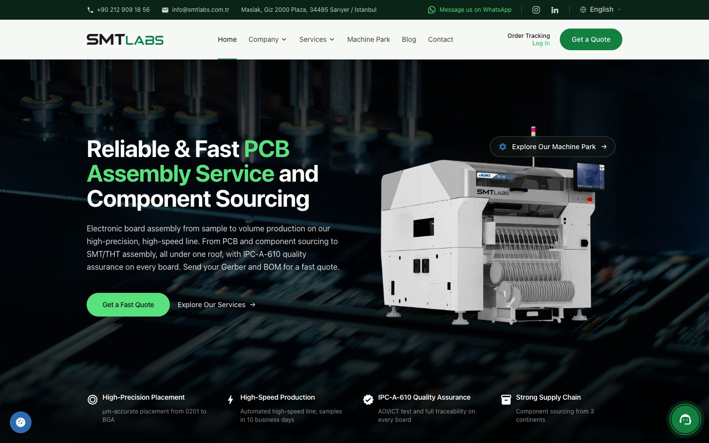
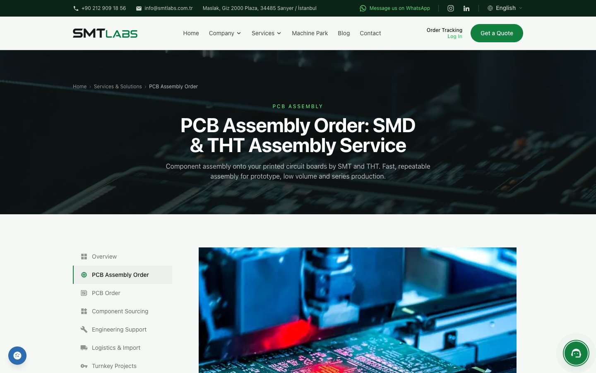
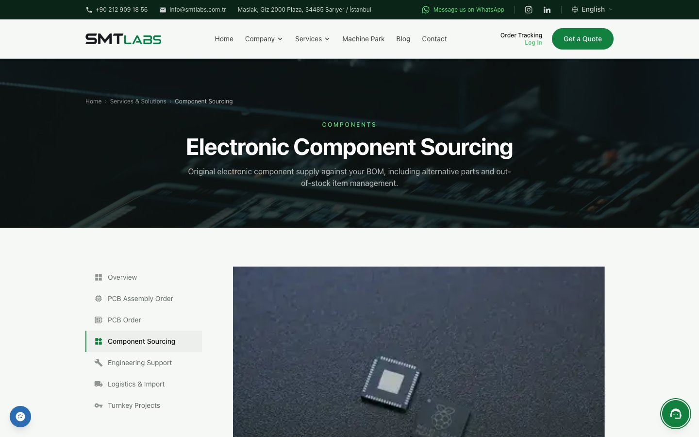
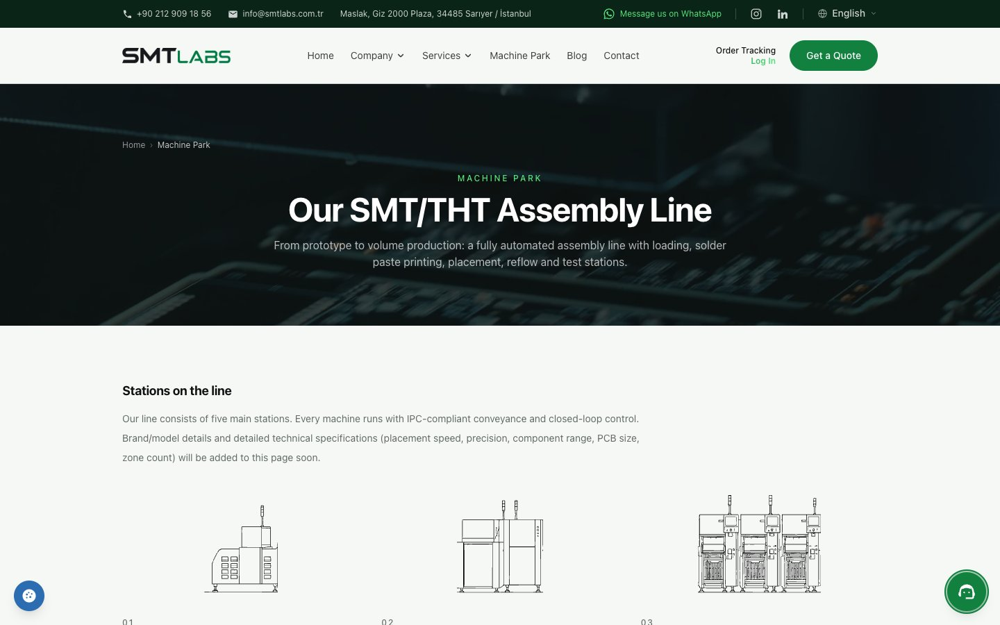
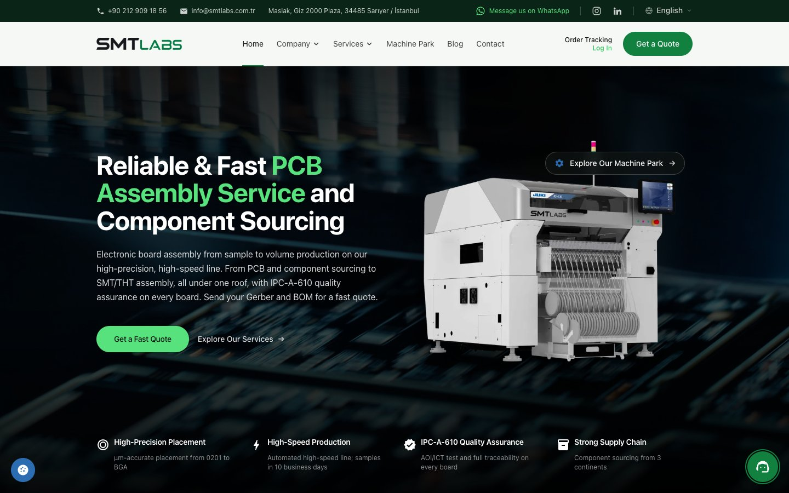
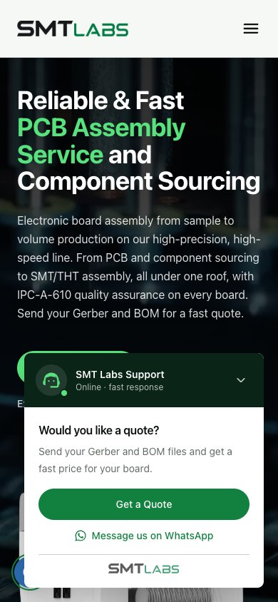

# SMT Labs: corporate website and online order portal

**Live:** [smtlabs.com.tr](https://smtlabs.com.tr) · **Stack:** Next.js 16, React 19, TypeScript, Tailwind v4, next-intl, Postgres · **Period:** Aug to Oct 2026

> 🇹🇷 **Özet:** İstanbul merkezli PCB dizgi ve komponent tedarik firması SMT Labs için 9 dilli kurumsal site ve çevrimiçi sipariş portalı. Gereksinimleri, bilgi mimarisini, içerik ve çok dil stratejisini, CRM / e-posta / spam koruması entegrasyonlarını ve SEO işlerini ben yürüttüm; kodlamayı yapay zekâ eşli programlama (AI tooling) ile yaptım. Kaynak kod ve müşteri verisi içeren ekranlar gizlidir.

## Context

SMT Labs is an Istanbul-based PCB assembly (PCBA) and component sourcing company. The brief: replace a template site with a fast, multilingual, search-friendly corporate site, and give customers an online way to request quotes and place and follow orders.

## My role

I led the project end to end and built it with an AI pair-programmer.

- **Requirements and information architecture:** URL map, service page template, content plan, design decisions
- **Multilingual rollout:** Turkish first, then English, then 7 more languages with localized URL slugs and hreflang
- **Integrations:** quote and contact forms into the company's CRM (Odoo), instant e-mail notifications (Resend), bot protection (reCAPTCHA v3)
- **Search visibility (SEO and GEO):** structured data, canonical and alternate-language setup, sitemap, search-console issue fixes
- **Quality and operations:** accessibility and UI/UX audits, loading states, error handling, deployment on Vercel
- 513 commits between 27 Aug and 31 Oct 2026, with a 2,500-line engineering journal recording decisions and root-cause analyses

## What I built

**Corporate site (9 languages: TR, EN, DE, FR, ES, IT, RU, UZ, AR)**
Home page, services (PCBA, PCB production, component sourcing, technical support, logistics and import, turnkey projects), machine park, company pages, quality policy, FAQ, legal pages, blog, social feed strip, quote and newsletter forms.

**Online order portal (TR / EN)**
Customer accounts, PCB and PCBA order form with technical options (quantity grid, thickness, layers, material, surface finish), file upload, delivery addresses, order cards with status and filters, order tracking, a staff console with multi-status filters and notifications, and a light / dark design system. *Portal screens are not shown here because they contain customer data.*

## Selected engineering stories

- **Duplicate-canonical warning in Google Search Console.** Root cause: the i18n middleware sent an automatic `hreflang` header that kept the trailing slash on the root URL, while the page `<head>` tags did not, so Google saw two conflicting signals. Fix: disabled the middleware's alternate-link header so the head tags became the single source of truth.
- **Order form stuck on "Submitting".** Traced and fixed a state bug that blocked order submission.
- **Admin notifications never arriving.** Diagnosed and fixed the delivery path, then lengthened the alert sound.
- **Ghost sessions.** Fixed sessions of deleted accounts that crashed the portal instead of signing the user out.
- **Slow deployments.** Found the root cause and stopped docs-only commits from triggering deploys.

## Screens

| | |
|---|---|
|  **PCB assembly service page** |  **Component sourcing page** |
|  **Machine park** |  **English version** |

 <b>Mobile</b>

Click any image for the full-page capture.

## Skills demonstrated

Project ownership from brief to launch · information architecture and content strategy · multilingual and localization engineering (9 languages, localized slugs, hreflang) · Next.js App Router, React and TypeScript · CRM, e-mail and anti-spam integrations · SEO, GEO and search-console debugging · order-flow and form UX · root-cause analysis and engineering documentation · AI-assisted development workflow

---

*The source code is private. Screenshots are captured from the public site; SMT Labs and its marks belong to their owner. © İlker Çetinkaya.*
